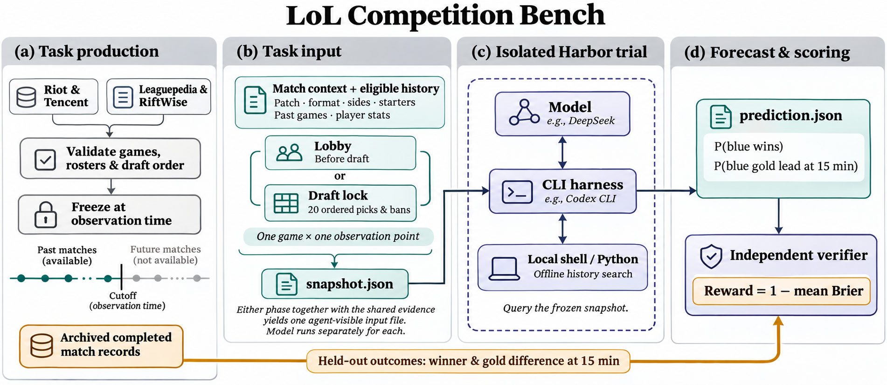

# LoL Competition Bench

[简体中文](README.md) · **English**

A Harbor benchmark for forecasting professional League of Legends. A model uses a native CLI to inspect the starting lineups and match records available at a fixed point in time. It predicts **the probability that blue side wins** and **the probability that blue side leads in gold at 15:00**. Each game yields two tasks, one before the draft and one after it locks. Run the same model through different CLIs to compare harnesses, or compare the two forecasts for each game to measure the value of draft information.

**2026 Worlds & LPL Regional Finals Forecasts** contains 198 Harbor tasks from 99 games across 46 series. The 87 Worlds games were played on tournament patch 26.20 and the 12 LPL Regional Finals games on 26.17. The CLI name is `worlds-lpl-2026`. [Dataset catalog and releases](datasets/README.md) · [Full example prompt](datasets/sample-draft-lock.md) · [RL and evaluation dataset card](datasets/rl-eval-v1/README.md)



## Five-game comparison

Start the local model scoreboard with `./bench serve`. The five games cover IG–TES, MVK–FURIA, Movistar KOI–BLG, LØS–LYON and KC–T1. Select a model and CLI, then open a prediction to see the evidence it queried, probability revisions and the submission the verifier scored. [Fixed selection](evaluation/suites/featured-five.json) · [Ten DeepSeek × Codex forecasts](evaluation/examples/featured-five-deepseek/report.md) · [Ten DeepSeek × Claude Code forecasts](evaluation/examples/featured-five-claude-deepseek/report.md) · [Free OpenRouter run and quota record](evaluation/examples/featured-five-openrouter/report.md)

```sh
./bench e2e --suite featured-five --list
./bench e2e --suite featured-five --backend macos --harness codex --model deepseek-v4-pro
```

The second command uses the host's `DEEPSEEK_API_KEY` and bills the account through the official DeepSeek API. Use `--harness claude` to run Claude Code on the same backend. The team marks come from [official LoL Esports assets](evaluation/site_assets/teams/sources.json).

Run `./bench audit` offline to verify the native traces, evidence cutoffs and scores. Each trial page shows the draft in order, links each forecast revision to its tool call, and lets you share a URL to an individual native event. Selected model claims have human reviews linked to the frozen evidence. [Five-game rollout review](evaluation/ROLLOUT_REVIEW.md) · [Worlds artwork and match photography credits](evaluation/site_assets/media/sources.json)

## A game from snapshot to score

At Worlds 2026, Karmine Corp played blue side against T1 in game two of their best-of-five quarterfinal. Both forecasting sessions could inspect 96 earlier games. Each KC starter appeared in 19 of them and each T1 starter in six. Looking up Faker reveals that he played Viktor in game one. Under the series' Fearless Draft rules, that pick removed Viktor from both teams' champion pools for game two.

The following forecasts came from **Codex CLI with `nvidia/nemotron-3.5-lightning:free`** via OpenRouter, in separate macOS sandboxes. T1 won the game, and KC trailed by 4,026 gold at 15:00. [Run report and tool-by-tool transcripts](evaluation/examples/worlds-2026-kc-t1-openrouter/report.md)

| Observation | Evidence about the target game | KC wins | KC leads at 15:00 | Reward |
| --- | --- | ---: | ---: | ---: |
| Pre-draft lobby · `lobby` | Patch, format, sides, ten starters and prior games | 45% | 55% | 0.74750 |
| Draft lock · `draft-lock` | The same evidence plus all 20 picks and bans in order | 60% | 55% | 0.66875 |

Each submission is a `prediction.json` containing `p_blue_win` and `p_blue_ahead_15`. For each binary event the Brier score is `(p − y)²`. Reward is one minus the mean of the two Brier scores. A gold tie at 15:00 gives the second event a label of zero. In this game the model raised KC's win probability after the draft, which lowered its reward. The suite reports paired differences across games for the broader comparison.

## Run locally

From the repository root, use Python 3.12 or later. The offline `simple` command scores the player-history baseline on one example. The read-only local site opens at `http://127.0.0.1:8765` after you start `serve`.

```sh
./bench simple
./bench e2e --release worlds-lpl-2026 --list --series worlds-2026-main-event-quarterfinals-4 --game 2
./bench serve
```

To run the same model and harness on both phases using macOS, install Codex CLI 0.167.0 and Xcode Command Line Tools, then export `OPEN_ROUTER_API_KEY` or `OPENROUTER_API_KEY` on the host. Free-model availability and rate limits depend on the provider.

```sh
./bench e2e --release worlds-lpl-2026 --backend macos --mode openrouter-free \
  --harness codex --model nvidia/nemotron-3.5-lightning:free \
  --series worlds-2026-main-event-quarterfinals-4 --game 2
```

Open the run's `report.md` or use the local site to inspect each prompt, input snapshot, native CLI messages, tool calls and outputs, submitted probabilities and score. The site exports leaderboard CSVs, trial results and run artifacts. Rebuild the readable report for an existing run offline with `./bench report <run-directory>`. The full controlled leaderboard requires every scheduled task. Failed and interrupted trials earn zero. Individual Brier scores cover successful submissions, and subsets are compared within identical task selections. [Installation and runners](evaluation/README.md) · [Ranking rules](evaluation/RANKING.md)

| CLI | Execution and verification |
| --- | --- |
| Claude Code, Codex, Pi and Kimi Code | Harbor with Docker runs each native CLI in an isolated worker behind a restricted inference gateway. Protocol fixtures exercise real CLI tools for all four. |
| Codex and Claude Code on macOS | Each trial gets a fresh Seatbelt sandbox. The host applies the same scoring function. This is the backend used for the example above. |
| Cursor CLI | Vendor mode uses a model available to the Cursor account and has its own leaderboard group. The credential-free test covers the worker boundary and unauthenticated startup. Cursor controls retrieval in its authenticated remote service. |

## Historical and live forecasts

The model may use local shell commands or Python to search and aggregate the frozen evidence. This includes historical drafts, results, K/D/A and 15-minute gold differences when recorded. Within a series, only earlier game numbers are visible. Other series require a complete replay published before the target series started. A controlled worker receives the instructions and one snapshot. The organizer retains the target labels and verifier. The forecast rules prohibit external search, cross-session evidence and using a remembered result for the target game. A model may already know a public match from its training data. [Temporal isolation checks](evaluation/README.md#验证-cli-能查历史读不到未来)

For a new game, the workflow is `init-game → freeze → forecast/submit → settle → release`. The organizer records each cutoff and its source with `close`. **Lobby submissions must arrive before the first public draft action. Draft-lock submissions must arrive before the game starts.** The frozen evidence and timestamped receipt support verification of a live forecast. [Collection, cutoffs and settlement](production/README.md)

## Datasets and contributions

| Directory | What it contains |
| --- | --- |
| [production/](production/README.md) | Source collection and validation, task compilation, frozen snapshots and the separate verifier. |
| [datasets/](datasets/README.md) | Immutable Harbor releases, manifests, and per-task coverage cards showing how much history each starter has. |
| [evaluation/](evaluation/README.md) | Baseline and native CLI runners, trajectories, reports and the local leaderboard. |

**Player evidence and task design can evolve independently.** Contributors can declare a boolean, enum or bounded integer in JSON and submit observations with a player, prior game, publication time and source. [See the kills-plus-assists dimension](production/evidence-packs/kill-involvements.json). Only records eligible at the task's cutoff enter its snapshot. Run `./bench specs` to list task categories, scoring contracts, background briefs and instruction profiles. The `scout-one-shot-v1` example adds a reusable background brief and a fictional worked example while keeping the two-event scoring contract. Use `--task-spec` to select a profile and `--with-pack` to include a reviewed evidence pack in a new release. [Contribute player evidence](production/evidence-packs/README.md) · [Extend task categories and one-shot instructions](production/registry/README.md)

**RL and evaluation exports** contain 126 training, 44 validation and 28 test examples, split chronologically by series start. Both phases and all games in a series stay in the same partition. Training exports include JSONL, Parquet and a reward callback, with a choice of inline chat messages or a tool workspace. Evaluation inputs and verifier labels are separate files. [Formats, Hugging Face loading and verl examples](datasets/rl-eval-v1/README.md)

**Sources and rights.** Riot and Tencent event records support format, matchup and series-result checks. Leaguepedia supplies the ordered-draft cross-check. RiftWise supplies player appearances and in-game statistics. The source archive covers 102 games. Three lacked required fields and were excluded from the task set. Season-wide retrospective player ratings stay in the organizer archive. Draft data derived from Leaguepedia is shared under CC BY-SA 3.0. Consult the source records for attribution and terms for the other inputs. [Per-series cross-checks](production/data/official-matches.json) · [Sources and attribution](production/README.md#既有赛季数据) · [CC BY-SA 3.0](https://creativecommons.org/licenses/by-sa/3.0/)
