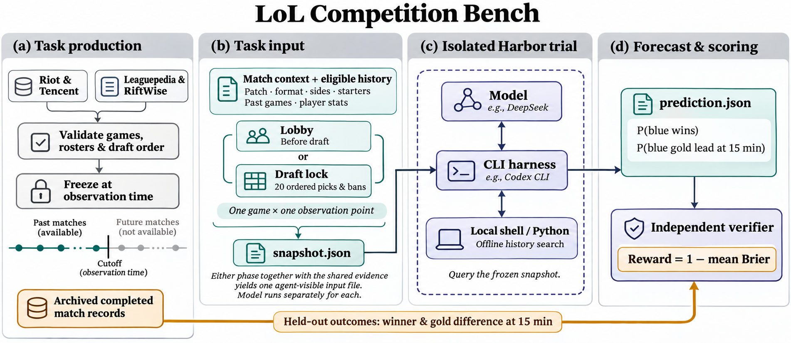

# LoL Competition Bench

**简体中文** · [English](README.en.md)

一个基于 Harbor 的英雄联盟职业比赛预测基准。给定真实对局、十名首发和当时可公开查询的历史，模型通过原生 CLI 检索证据，分别预测**蓝方获胜概率**与**蓝方在 15:00 经济领先的概率**。每局在 BP（禁选）前后各出一道题。同一模型更换 CLI 可以比较 harness。同一配置对照两个时点可以衡量完整 BP 带来的信息增益。

**2026 世界赛与 LPL 区域资格赛预测集**收录 46 个系列赛、99 个小局、198 道 Harbor 题目。世界赛的 87 局使用比赛版本 26.20，LPL 区域资格赛的 12 局使用 26.17。命令行名称为 `worlds-lpl-2026`。[题集目录与版本](datasets/README.md) · [完整题面](datasets/sample-draft-lock.md) · [RL 训练与评测数据卡](datasets/rl-eval-v1/README.md)



## 五场对照

用 `./bench serve` 打开本地模型成绩页。五场覆盖 IG–TES、MVK–FURIA、Movistar KOI–BLG、LØS–LYON、KC–T1，同一模型可通过不同 CLI 对照。点击任一阶段的预测，可以查看它检索了哪些证据、怎样修订概率，以及实际向裁判提交的文件。[固定题单](evaluation/suites/featured-five.json) · [OpenRouter 免费运行及配额记录](evaluation/examples/featured-five-openrouter/report.md)

```sh
./bench e2e --suite featured-five --list
./bench e2e --suite featured-five --backend macos --harness codex --model deepseek-v4-pro
```

第二条命令使用宿主 `DEEPSEEK_API_KEY` 调用 DeepSeek 官方付费 API。换用 `--harness claude` 可在同一环境运行 Claude Code。队徽来自[LoL Esports 官方赛事资源](evaluation/site_assets/teams/sources.json)。

## 从一场真实比赛看输入、预测与评分

2026 世界赛四分之一决赛，KC 蓝方对 T1 红方，BO5 第二局。两个独立会话都能查 96 个历史小局，其中 KC 五名首发各有 19 局记录，T1 五名首发各有 6 局。比如检索 Faker 的过往出场，可以查到他在本系列第一局选过 Viktor。按本场 Fearless 规则，双方第二局都无法再选这个英雄。

下表是 **Codex CLI × `nvidia/nemotron-3.5-lightning:free`** 经 OpenRouter 在 macOS 沙箱中的一次实测。真实赛果是 T1 胜，KC 在 15:00 落后 4,026 金。[运行报告和逐步工具轨迹](evaluation/examples/worlds-2026-kc-t1-openrouter/report.md)

| 观测时点 | 模型可见的当局输入 | KC 获胜 | KC 在 15:00 领先 | reward |
| --- | --- | ---: | ---: | ---: |
| BP 前 · `lobby` | 补丁、赛制、选边、十名首发与历史 | 45% | 55% | 0.74750 |
| BP 锁定 · `draft-lock` | 上述输入，加上本局全部 20 手禁选及顺位 | 60% | 55% | 0.66875 |

每题交一份 `prediction.json`，含 `p_blue_win`、`p_blue_ahead_15`。设实际标签为 0 或 1，每项 Brier 为 `(p − y)²`。单题 reward 为 1 减去两项 Brier 的平均值，15:00 经济持平计作蓝方未领先。本例中看到 BP 后，模型调高了 KC 的胜率，第二项概率不变，得分下降。判断 BP 的总体价值要在多局上配对比较。

## 本地运行

在仓库根目录使用 Python 3.12+。`simple` 用选手历史基线完成一道题，全程离线。`serve` 启动只读本地站点，默认地址为 `http://127.0.0.1:8765`。

```sh
./bench simple
./bench e2e --release worlds-lpl-2026 --list --series worlds-2026-main-event-quarterfinals-4 --game 2
./bench serve
```

以下命令复跑上面的两道题。macOS 需要 Codex CLI 0.167.0、Xcode Command Line Tools 及已导出的 `OPEN_ROUTER_API_KEY` 或 `OPENROUTER_API_KEY`。免费路由的可用性与限流由提供方决定。

```sh
./bench e2e --release worlds-lpl-2026 --backend macos --mode openrouter-free \
  --harness codex --model nvidia/nemotron-3.5-lightning:free \
  --series worlds-2026-main-event-quarterfinals-4 --game 2
```

打开本轮的 `report.md` 或本地站点，可逐题核对题面、输入快照、原生 CLI 消息、工具命令与输出、最终概率和评分。站点支持导出榜单 CSV、逐题结果和运行材料。已有运行可用 `./bench report <运行目录>` 离线重建可读报告。完整受控榜要求覆盖全套题，每轮失败或中断的题计零。Brier 只统计成功交卷。子集仅在相同题号集合内比较。[安装、后端与用量](evaluation/README.md) · [榜单规则](evaluation/RANKING.md)

| CLI | 可运行的环境与验证范围 |
| --- | --- |
| Claude Code、Codex、Pi、Kimi Code | 在 Harbor + Docker 中用独立 CLI worker 和受限推理网关运行。四个 CLI 都支持固定响应驱动的原生工具验收。 |
| Codex、Claude Code 的 macOS 后端 | 另支持每题新建 Seatbelt 沙箱，宿主侧使用同一评分函数，可复现上面的模型调用。 |
| Cursor CLI | 使用 `--mode vendor` 与 Cursor 账号提供的模型，单列厂商赛道。免密钥验收覆盖 worker 隔离和未登录启动，认证后的远端检索行为由厂商控制。 |

## 历史边界与新比赛

模型可以用本地 shell 或 Python 查找、筛选和汇总冻结材料。历史可包含过去的 BP、比分、K/D/A 和 15 分钟经济差。同系列只开放更小局号，其他系列须在目标系列开赛前已有完整公开回放。受控 worker 只收到题面和当题快照。当局真值和验证器留在组织者侧。禁止外网检索、跨会话取证和引用记忆中的本局赛果。公开比赛仍可能存在于模型训练数据中。[防穿越验收命令](evaluation/README.md#验证-cli-能查历史读不到未来)

新比赛按 `init-game → freeze → forecast/submit → settle → release` 进入题集。组织者用 `close` 记录对应时点和证据，**BP 前交卷须早于第一手 BP 公开，BP 后交卷须早于游戏实际开始**。冻结的输入与交卷回执用于区分赛前预测和历史重放。[采集、关窗与赛后结算](production/README.md)

## 数据与贡献

| 模块 | 用途 |
| --- | --- |
| [production/](production/README.md) | 采集和校验真实比赛，生成题面、快照与独立评分器。 |
| [datasets/](datasets/README.md) | 保存不可变 Harbor 题集、校验清单及每题的选手历史覆盖卡。 |
| [evaluation/](evaluation/README.md) | 运行基线或原生 CLI，保存轨迹、评测结果和本地排行榜。 |

**选手资料与题目规程可独立扩展。** 贡献者可以在 JSON 中直接声明布尔、枚举或有界整数维度，再按选手、历史小局、公开时间和来源提交记录。[示例：击杀与助攻之和](production/evidence-packs/kill-involvements.json)。只有满足当题时间边界的记录才会进入快照。`./bench specs` 列出任务类别、评分合同、背景资料和运行指令。示例 `scout-one-shot-v1` 在同一评分合同上加入独立背景和一个虚构对局示范。用 `--task-spec` 选择规格，用 `--with-pack` 加载经审证据包，再发布新版本。[提交选手证据卡](production/evidence-packs/README.md) · [扩展任务和 one-shot 指令](production/registry/README.md)

**RL / Eval 导出**按系列赛开始时间切分为 126 条训练、44 条验证和 28 条测试样本。同一系列的各局和两个 BP 时点属于同一分区。训练材料含 JSONL、Parquet 和 reward 回调，支持纯消息或可查快照的工具环境。评测输入与组织者的真值文件分开保存。[数据格式、Hugging Face 与 verl 示例](datasets/rl-eval-v1/README.md)

**来源与使用条款。** Riot、腾讯赛事记录用于核对赛制、对阵及系列赛比分，Leaguepedia 提供逐手 BP 对照，RiftWise 提供出场及局内统计。归档含 102 小局，3 局因技术字段不全未入题。按赛季重算的赛后评分保留在组织者归档。Leaguepedia 衍生 BP 数据沿用 CC BY-SA 3.0。其他来源的归属与使用条件按各自记录核对。[逐系列对照](production/data/official-matches.json) · [数据来源与署名](production/README.md#既有赛季数据) · [CC BY-SA 3.0](https://creativecommons.org/licenses/by-sa/3.0/)
